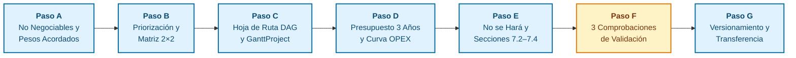
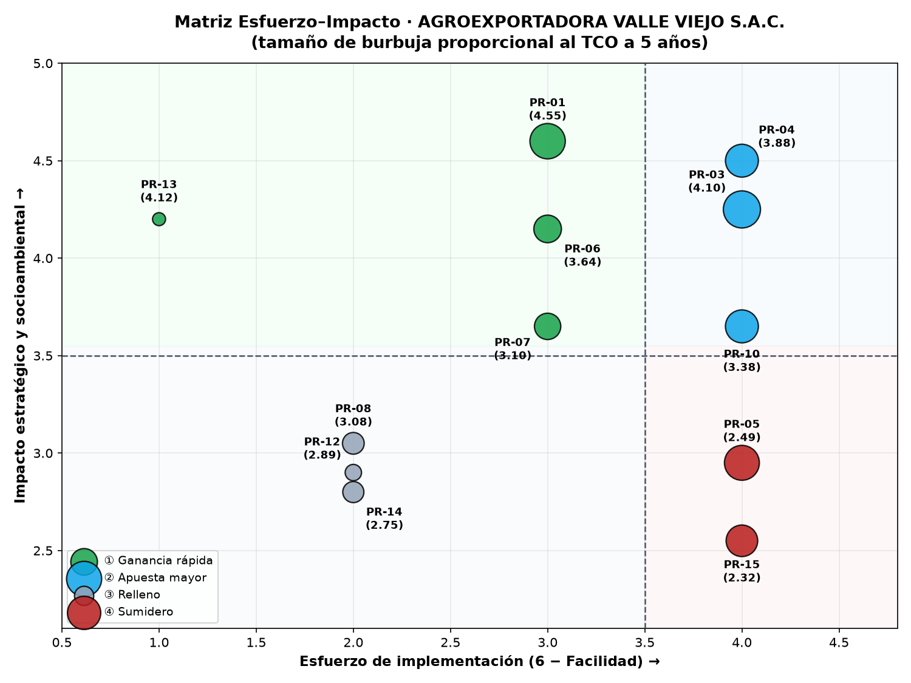
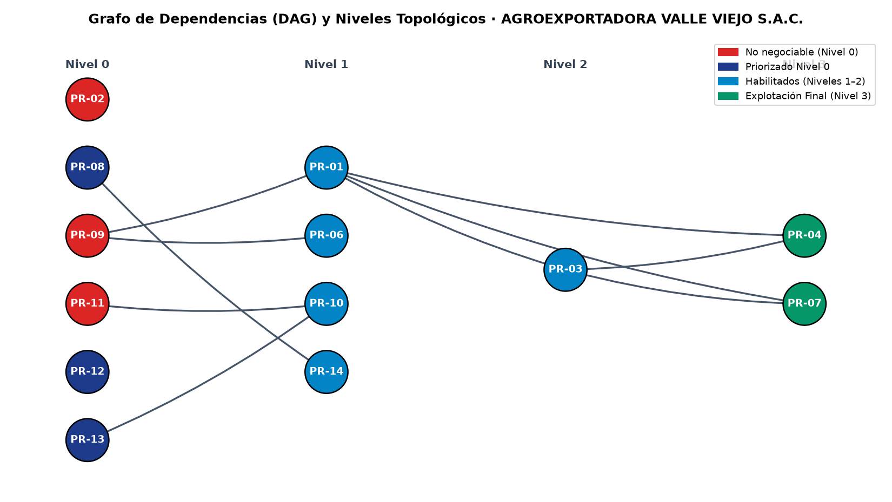
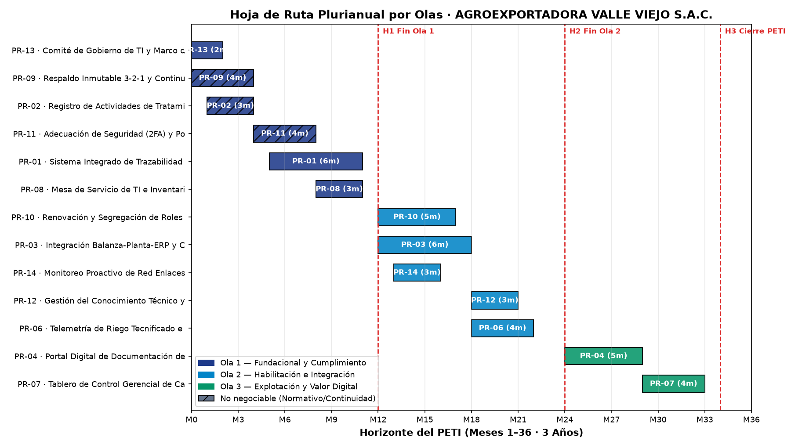
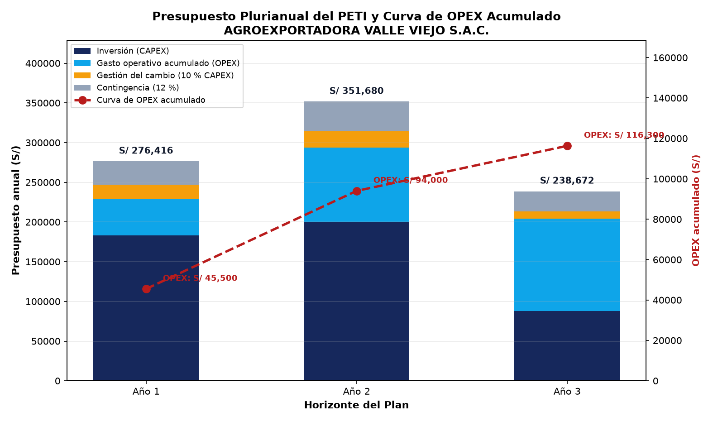
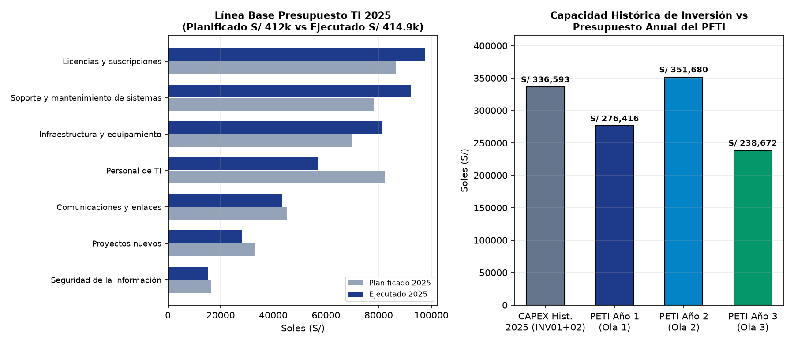

# INFORME DE LABORATORIO · TALLER SEMANA 14
## Priorización Multicriterio, Hoja de Ruta y Presupuesto Plurianual

---

<div align="center">

### UNIVERSIDAD PRIVADA DE TACNA
**FACULTAD DE INGENIERÍA**  
**Escuela Profesional de Ingeniería de Sistemas**

---

**ASIGNATURA:**  
Planeamiento Estratégico de Tecnologías de Información (SI-886)  
Semestre Académico 2026-II

**DOCENTE:**  
Dr. Oscar Juan Jimenez Flores

**CASO DE ESTUDIO:**  
EMPRESA 01 — **AGROEXPORTADORA VALLE VIEJO S.A.C.**  
*(Agroexportación · aceituna y aceite de oliva · La Yarada-Los Palos, Tacna)*

**INTEGRANTE / EQUIPO DE TRABAJO (GRUPO 01):**  
- **Ramos Fabricio**
- **Colque Rodrigo**
- **Arocutipa Gian Franco**
- **Perez Fabrizio**

**ENLACE AL REPOSITORIO DE GITHUB:**  
[https://github.com/FabricioRams/SI886-S14-TALLER-Grupo1](https://github.com/FabricioRams/SI886-S14-TALLER-Grupo1)

Tacna, Perú  
Noviembre 2026

</div>

---

## Tabla de Contenidos

- [1. Información General y Objetivos del Taller](#1-información-general-y-objetivos-del-taller)
  - [1.1 Objetivos de la Práctica](#11-objetivos-de-la-práctica)
  - [1.2 Tecnologías y Herramientas Aplicadas](#12-tecnologías-y-herramientas-aplicadas)
  - [1.3 Seguridad y Confidencialidad](#13-seguridad-y-confidencialidad)
- [2. Procedimiento Metodológico y Resultados Obtenidos Paso a Paso](#2-procedimiento-metodológico-y-resultados-obtenidos-paso-a-paso)
  - [Paso A — Separar los no negociables y fijar los pesos](#paso-a--separar-los-no-negociables-y-fijar-los-pesos)
  - [Paso B — Calcular la priorización y matriz esfuerzo-impacto](#paso-b--calcular-la-priorización-y-matriz-esfuerzo-impacto)
  - [Paso C — Construir la hoja de ruta por olas y cronograma](#paso-c--construir-la-hoja-de-ruta-por-olas-y-cronograma)
  - [Paso D — Presupuesto plurianual y curva de OPEX acumulado](#paso-d--presupuesto-plurianual-y-curva-de-opex-acumulado)
  - [Paso E — Declarar lo que no se hará y redactar secciones 7.2 a 7.4 del PETI](#paso-e--declarar-lo-que-no-se-hará-y-redactar-secciones-72-a-74-del-peti)
  - [Paso F — Validar y corregir (tres comprobaciones obligatorias)](#paso-f--validar-y-corregir-tres-comprobaciones-obligatorias)
  - [Paso G — Registro de evidencia, versionamiento y transferencia de riesgo](#paso-g--registro-de-evidencia-versionamiento-y-transferencia-de-riesgo)
- [3. Lista de Comprobación del Taller (Resultados y Evidencias)](#3-lista-de-comprobación-del-taller-resultados-y-evidencias)
- [4. Conclusiones](#4-conclusiones)
- [5. Referencias Bibliográficas](#5-referencias-bibliográficas)
- [6. Estructura del Repositorio](#6-estructura-del-repositorio)
- [7. Reproducibilidad](#7-reproducibilidad)
- [8. Glosario de Siglas](#8-glosario-de-siglas)

---

## 1. Información General y Objetivos del Taller

### 1.1 Objetivos de la Práctica
- Separar los **proyectos no negociables** del modelo de competencia estratégica (por mandato normativo o riesgo crítico de continuidad) y ubicarlos según su plazo límite con margen preventivo.
- Diseñar y acordar con la gerencia el **modelo de priorización multicriterio** con pesos derivados del diagnóstico de **AGROEXPORTADORA VALLE VIEJO S.A.C.**, incorporando obligatoriamente el criterio **Impacto social y ambiental** con un peso no menor al 10 %.
- Calcular el puntaje ponderado de cada iniciativa competitiva y construir la **matriz esfuerzo-impacto** poblando sus cuatro cuadrantes.
- Declarar explícitamente los proyectos del cuadrante **④ Sumidero que NO se ejecutarán**, identificando el objetivo sin cumplir, el riesgo asumido y el responsable de aceptarlo.
- Construir la **hoja de ruta en tres olas** (36 meses) respetando dependencias técnicas en un grafo acíclico dirigido (DAG), capacidad simultánea (equipo TI de 3 personas) y absorción del cambio organizacional, además de modelarla en **GanttProject**.
- Elaborar el **presupuesto plurianual** desglosado en CAPEX, OPEX acumulado, gestión del cambio (10 %) y contingencia (12 %), interpretando la **curva de OPEX acumulado** y presentando las cifras con su rango de incertidumbre (±15 %).
- Redactar formalmente las secciones **7.2, 7.3 y 7.4 del PETI** de la organización.

### 1.2 Tecnologías y Herramientas Aplicadas
- **Python 3.14 + `pandas` + `matplotlib` + `networkx`:** Procesamiento de portafolio (`PR01_no_negociables.py`), cálculo multicriterio y matriz esfuerzo-impacto (`PR03_priorizacion.py`), ordenamiento topológico y verificación de capacidad (`PR04_hoja_ruta.py`), presupuesto plurianual y curva de OPEX (`PR06_presupuesto.py`) y suite de validación (`PR08_validacion.py`).
- **GanttProject (XML `.gan`):** Modelamiento del cronograma plurianual en tres olas con enlaces fin-inicio, hitos de decisión (*Stage-Gate* H1, H2, H3) y plazos normativos en rojo (`07_portafolio/PR05_hoja_ruta.gan`).
- **Git / GitHub:** Control de versiones reproducible con estructura modular (`07_portafolio/`, `graficos/`, `evidencias/S14/salidas/`).

### 1.3 Seguridad y Confidencialidad
- El presupuesto institucional de TI (**S/ 412 000**, 0.87 % de la facturación anual de **S/ 47.3 millones**), las partidas ejecutadas (`presupuesto_ti.csv`) y los expedientes de inversiones cerradas (`inversiones_cerradas.csv` y `expedientes-de-inversion.md`) se tratan bajo clasificación **Confidencial / Restringido**.
- El criterio **Impacto social y ambiental** se fijó en **12 %** (≥ 10 %) **antes** de calcular los puntajes en `PR03_priorizacion.py`.
- Todas las cifras presupuestales se expresan con su **rango de incertidumbre (±15 %)** y los proyectos descartados se comunican de manera transparente a la gerencia.

---

## 2. Procedimiento Metodológico y Resultados Obtenidos Paso a Paso



---

### Paso A — Separar los no negociables y fijar los pesos

A partir del portafolio candidato de **AGROEXPORTADORA VALLE VIEJO S.A.C.** (`07_portafolio/PF01_portafolio_candidatos.csv`, 15 iniciativas derivadas de sus brechas en `FICHA.md`), se ejecutó [`07_portafolio/PR01_no_negociables.py`](07_portafolio/PR01_no_negociables.py) para aislar los **3 proyectos no negociables** que no compiten por puntaje:

1. **PR-09 · Respaldo Inmutable 3-2-1 y Continuidad de Sistemas de Planta:** Obligatorio por continuidad crítica y exigencia SENASA-UE (Plazo límite: `2027-Q1`). En 2024 el archivo maestro Access de trazabilidad se corrompió sin respaldo y tomó 3 semanas de reconstrucción en plena campaña.
2. **PR-02 · Registro de Actividades de Tratamiento y Cumplimiento LPDP:** Obligatorio por `D.S. 016-2024-JUS / Ley 29733` (Plazo límite: `2027-Q2`), cubriendo datos de 142 trabajadores fijos, 380 temporales en campaña (may–ago) y productores asociados.
3. **PR-11 · Adecuación de Seguridad (2FA) y Política de Seguridad de TI:** Obligatorio por `Ley 29733 art. 9 / D.S. 016-2024-JUS` (Plazo límite: `2027-Q2`), ante cuentas de administrador compartidas, acceso compartido almacén-compras en ERP, ausencia de 2FA y política en borrador hace 2 años.

```text
=== PROYECTOS NO NEGOCIABLES (AGROEXPORTADORA VALLE VIEJO S.A.C.) ===
codigo                                                       nombre                                  norma_nn         plazo_limite
 PR-02   Registro de Actividades de Tratamiento y Cumplimiento LPDP             D.S. 016-2024-JUS / Ley 29733 2027-Q2 (Año 1 - S2)
 PR-09 Respaldo Inmutable 3-2-1 y Continuidad de Sistemas de Planta Continuidad crítica / Exigencia SENASA-UE 2027-Q1 (Año 1 - S1)
 PR-11  Adecuación de Seguridad (2FA) y Política de Seguridad de TI      Ley 29733 art. 9 / D.S. 016-2024-JUS 2027-Q2 (Año 1 - S2)

-> NO entran al modelo de priorización. Se ubican en la hoja de ruta por su plazo,
   con al menos un trimestre de margen antes de la fecha límite.

Proyectos que sí compiten en el modelo: 12
```
*Salida completa en [`evidencias/S14/salidas/salida_PR01_no_negociables.txt`](evidencias/S14/salidas/salida_PR01_no_negociables.txt).*

#### Pesos acordados con la gerencia (`07_portafolio/PR02_pesos.md`)
Antes de calcular puntajes, en la **Entrevista 3 simulada** con Administración y Finanzas se fijaron los 8 pesos considerando la restricción de **3 personas en TI**, las desviaciones históricas de inversión (`INV02` +20.6 %, `INV03` +24.5 % sin actas ni medición de valor) y la prioridad de trazabilidad de exportación (reducir reconstrucción de 11 a 2 días):

| # | Criterio | Peso | Justificación acordada con la gerencia |
|:---:|:---|---:|:---|
| 1 | Contribución a los objetivos | **0.22** | Sostener la trazabilidad hacia España, Brasil, Chile y EE. UU. y reducir el cierre de campaña de 11 a 2 días. |
| 2 | Beneficio económico | **0.18** | Proteger márgenes sobre S/ 47.3 M de facturación y exigir retorno tras sobrecostos previos (+20.6 % / +24.5 %). |
| 3 | Habilitación | **0.15** | Superar el aislamiento entre Access 2014, balanza 2012 sin red y ERP on-premise 2016. |
| 4 | Urgencia | **0.13** | Riesgo latente de falla en Access mantenido por un exempleado y PC de balanza sin soporte. |
| 5 | **Impacto social y ambiental** | **0.12** | **Obligatorio (≥ 10 %).** Gestión hídrica ante ANA (La Yarada-Los Palos), reducción de papel y formalización de 380 temporales. |
| 6 | Riesgo de no hacerlo | **0.10** | Evitar rechazo de embarques europeos, sanciones SENASA/ANA/SUNAFIL y pérdida de certificaciones. |
| 7 | Facilidad de ejecución | **0.05** | **Equipo de TI de 3 personas:** severa restricción de capacidad interna. |
| 8 | Aceptación organizacional | **0.05** | Sin Comité de TI previo y con picos operativos en campaña (mayo–agosto). |
| | **TOTAL** | **1.00** | **Comprobado: $\sum w_i = 1.00$.** |

---

### Paso B — Calcular la priorización y matriz esfuerzo-impacto

Al ejecutar [`07_portafolio/PR03_priorizacion.py`](07_portafolio/PR03_priorizacion.py) sobre los 12 proyectos competitivos y sus costos (`PF02_tco.csv`), se obtuvo el ranking ponderado y la clasificación en los cuatro cuadrantes de la matriz esfuerzo-impacto:

| Ranking | Código | Nombre del Proyecto | Puntaje | Impacto | Esfuerzo | Cuadrante | TCO 5 años (±15 %) |
|:---:|:---:|:---|---:|---:|---:|:---|---:|
| 1 | **PR-01** | Sistema Integrado de Trazabilidad de Lotes (Reemplazo Access) | **4.55** | 4.60 | 3.0 | ① Ganancia rápida | S/ 140 500 (S/ 119k – 162k) |
| 2 | **PR-13** | Comité de Gobierno de TI y Marco de Inversiones (EDM02/APO05) | **4.12** | 4.20 | 1.0 | ① Ganancia rápida | S/ 19 000 (S/ 16k – 22k) |
| 3 | **PR-03** | Integración Balanza-Planta-ERP y Capa de Servicios | **4.10** | 4.25 | 4.0 | ② Apuesta mayor | S/ 155 000 (S/ 132k – 178k) |
| 4 | **PR-04** | Portal Digital de Documentación de Exportación y Clientes B2B | **3.88** | 4.50 | 4.0 | ② Apuesta mayor | S/ 121 500 (S/ 103k – 140k) |
| 5 | **PR-06** | Telemetría de Riego Tecnificado e Integración Hídrica (ANA) | **3.64** | 4.15 | 3.0 | ① Ganancia rápida | S/ 85 500 (S/ 73k – 98k) |
| 6 | **PR-10** | Renovación y Segregación de Roles del ERP On-Premise | **3.38** | 3.65 | 4.0 | ② Apuesta mayor | S/ 122 000 (S/ 104k – 140k) |
| 7 | **PR-07** | Tablero de Control Gerencial de Campaña y Costos (BI) | **3.10** | 3.65 | 3.0 | ① Ganancia rápida | S/ 78 000 (S/ 66k – 90k) |
| 8 | **PR-08** | Mesa de Servicio de TI e Inventario de Activos (ITIL) | **3.08** | 3.05 | 2.0 | ③ Relleno | S/ 53 000 (S/ 45k – 61k) |
| 9 | **PR-12** | Gestión del Conocimiento Técnico y Capacitación en Seguridad | **2.89** | 2.90 | 2.0 | ③ Relleno | S/ 30 000 (S/ 26k – 35k) |
| 10 | **PR-14** | Monitoreo Proactivo de Red Enlaces y Servidor de Planta | **2.75** | 2.80 | 2.0 | ③ Relleno | S/ 50 000 (S/ 43k – 58k) |
| 11 | **PR-05** | Portal de Acopio y Liquidación para Productores Asociados | **2.49** | 2.95 | 4.0 | ④ Sumidero | S/ 137 000 *(Excluido)* |
| 12 | **PR-15** | Portal de Autoservicio de Trabajadores y Campaña (380 temp.) | **2.32** | 2.55 | 4.0 | ④ Sumidero | S/ 112 000 *(Excluido)* |


*Figura 1: Matriz Esfuerzo–Impacto del portafolio competitivo de AGROEXPORTADORA VALLE VIEJO S.A.C. (el tamaño de burbuja representa el TCO a 5 años). Fuente: [`graficos/PR_esfuerzo_impacto.png`](graficos/PR_esfuerzo_impacto.png).*

- **① Ganancia rápida (`PR-01`, `PR-13`, `PR-06`, `PR-07`):** Lideran el valor inmediato al reemplazar Access, instaurar gobierno de TI y automatizar el control hídrico ante ANA.
- **② Apuesta mayor (`PR-03`, `PR-04`, `PR-10`):** Iniciativas estructurales de integración física (balanza-planta-ERP) y digital (portal B2B), que requieren contratación externa supervisada.
- **③ Relleno (`PR-08`, `PR-12`, `PR-14`):** Mejoras de control operativo de bajo esfuerzo.
- **④ Sumidero (`PR-05`, `PR-15`):** Descartados explícitamente por su alto esfuerzo de adopción rural/estacional frente a un impacto relativo menor en el horizonte actual.

---

### Paso C — Construir la hoja de ruta por olas y cronograma

Mediante [`07_portafolio/PR04_hoja_ruta.py`](07_portafolio/PR04_hoja_ruta.py) (NetworkX) se modeló el grafo dirigido acíclico (DAG) de los **13 proyectos aprobados** (3 no negociables + 10 priorizados), determinando cuatro niveles topológicos:
- **Nivel 0 (inicio inmediato):** `PR-02`, `PR-08`, `PR-09`, `PR-11`, `PR-12`, `PR-13`
- **Nivel 1:** `PR-01` (depende de `PR-09`), `PR-06` (depende de `PR-09`), `PR-10` (depende de `PR-11`, `PR-13`), `PR-14` (depende de `PR-08`)
- **Nivel 2:** `PR-03` (depende de `PR-01`)
- **Nivel 3:** `PR-04` y `PR-07` (dependen de `PR-01` y `PR-03`)


*Figura 2: Grafo dirigido acíclico (DAG) y niveles topológicos de ejecución. Fuente: [`graficos/PR_dependencias_dag.png`](graficos/PR_dependencias_dag.png).*

Con base en este ordenamiento y respetando la capacidad simultánea máxima de **3 proyectos** (para un equipo de 3 personas en TI con apoyo externo puntual) y sin superponer dos proyectos de alto impacto en la misma área usuaria, se estructuró [`07_portafolio/PR05_hoja_ruta.csv`](07_portafolio/PR05_hoja_ruta.csv) y el proyecto GanttProject [`07_portafolio/PR05_hoja_ruta.gan`](07_portafolio/PR05_hoja_ruta.gan):

| Ola | Horizonte | Proyectos | CAPEX de Ola (S/) | Hito de Decisión (*Stage-Gate*) |
|:---|:---|:---|---:|:---|
| **Ola 1 — Fundacional y Cumplimiento** | Año 1 (S1–S2, M1–M12) | `PR-13`, `PR-09`, `PR-02`, `PR-11`, `PR-01`, `PR-08` | S/ 183 000 | **H1 (Mes 12):** Respaldo 3-2-1 probado, LPDP cumplida y trazabilidad en producción |
| **Ola 2 — Habilitación e Integración** | Año 2 (S1–S2, M13–M24) | `PR-10`, `PR-03`, `PR-14`, `PR-12`, `PR-06` | S/ 200 000 | **H2 (Mes 24):** Balanza-Planta-ERP integrado, roles segregados y telemetría ANA |
| **Ola 3 — Explotación y Valor Digital** | Año 3 (S1–S2, M25–M34) | `PR-04`, `PR-07` | S/ 88 000 | **H3 (Mes 34):** Portal B2B activo, Tablero BI y medición de beneficios ex-post |


*Figura 3: Cronograma plurianual por olas (36 meses) con hitos de decisión y proyectos no negociables resaltados. Fuente: [`graficos/PR_hoja_ruta_gantt.png`](graficos/PR_hoja_ruta_gantt.png).*

```text
=== VERIFICACIÓN ESTRICTA DE PRECEDENCIAS Y CAPACIDAD (MES A MES) ===
Dependencias rotas detectadas: 0
Capacidad simultánea declarada: 3 proyectos
Máximo de proyectos simultáneos observados: 3 (en mes(es): [2, 14, 15, 16])
✓ Capacidad simultánea respetada en los 36 meses (12 trimestres).
```
*Salida completa en [`evidencias/S14/salidas/salida_PR04_hoja_ruta.txt`](evidencias/S14/salidas/salida_PR04_hoja_ruta.txt).*

---

### Paso D — Presupuesto plurianual y curva de OPEX acumulado

Ejecutando [`07_portafolio/PR06_presupuesto.py`](07_portafolio/PR06_presupuesto.py) se consolidó el presupuesto plurianual en [`07_portafolio/PR06_presupuesto.csv`](07_portafolio/PR06_presupuesto.csv), incluyendo **10 % de gestión del cambio** sobre el CAPEX y **12 % de reserva de contingencia** sobre el subtotal:

| Año | Proyectos | CAPEX (S/) | OPEX Acumulado (S/) | Gestión del Cambio (10 %) | Contingencia (12 %) | Total Anual (S/) | Rango de Incertidumbre (±15 %) |
|:---|---:|---:|---:|---:|---:|---:|---:|
| **Año 1** | 6 | 183 000 | 45 500 | 18 300 | 29 616 | **276 416** | S/ 234 954 – S/ 317 878 |
| **Año 2** | 5 | 200 000 | 94 000 | 20 000 | 37 680 | **351 680** | S/ 298 928 – S/ 404 432 |
| **Año 3** | 2 | 88 000 | 116 300 | 8 800 | 25 572 | **238 672** | S/ 202 871 – S/ 274 473 |
| **TOTAL** | **13** | **471 000 (54.3 %)** | **255 800 (29.5 %)** | **47 100 (5.4 %)** | **92 868 (10.7 %)** | **866 768** | **S/ 736 753 – S/ 996 783** |


*Figura 4: Presupuesto plurianual del PETI (barras apiladas) y curva de OPEX acumulado creciente. Fuente: [`graficos/PR_presupuesto.png`](graficos/PR_presupuesto.png).*

**Interpretación de la curva de OPEX acumulado:**  
El OPEX incremental pasa de **S/ 45 500** en el Año 1 a **S/ 94 000** en el Año 2 y **S/ 116 300** en el Año 3 (**×2.56**). Cada proyecto entregado suma licenciamiento, soporte y mantenimiento permanente que **nunca disminuye**. Contrastado con la línea base de la empresa (`presupuesto_ti.csv`: S/ 412 000 planificado, S/ 414 893 ejecutado) y sus inversiones históricas (`inversiones_cerradas.csv`: S/ 336 593 ejecutados en 2025 solo en `INV01` + `INV02`), el plan es financieramente viable y ordena el gasto dentro de márgenes ya demostrados por la organización.


*Figura 5: Contraste entre la línea base presupuestal TI 2025, la capacidad histórica de inversión (INV01+INV02) y el presupuesto anual del PETI. Fuente: [`graficos/PR_comparacion_presupuesto.png`](graficos/PR_comparacion_presupuesto.png).*

---

### Paso E — Declarar lo que no se hará y redactar secciones 7.2 a 7.4 del PETI

Los dos proyectos ubicados en el cuadrante **④ Sumidero** fueron formalizados en [`07_portafolio/PR07_no_se_hara.csv`](07_portafolio/PR07_no_se_hara.csv) para comunicación explícita a la gerencia:

| Proyecto | Puntaje | Cuadrante | Objetivo que queda sin cumplir | Riesgo que la organización asume | Responsable de aceptar el riesgo | Fecha de revisión |
|:---:|---:|:---:|:---|:---|:---|:---|
| **PR-05** | 2.49 | ④ Sumidero | OD-03: Digitalizar relación comercial directa con productores asociados. | Registro manual de guías de acopio y liquidaciones en ERP/Excel; menor agilidad en cierre con proveedores agrícolas. | Gerente de Administración y Finanzas / Jefe de Acopio | 2028-06-30 (Hito H2) |
| **PR-15** | 2.32 | ④ Sumidero | OD-01: Autoservicio digital para 142 fijos y 380 temporales en campaña. | Envío tercerizado de planillas vía Excel por correo; carga administrativa en RR.HH. durante mayo–agosto. | Jefe de Recursos Humanos / Administración y Finanzas | 2028-06-30 (Hito H2) |

Asimismo, se redactaron de manera completa las secciones **7.2 (Priorización del portafolio)**, **7.3 (Hoja de ruta)** y **7.4 (Presupuesto)** en el documento normativo [`07_portafolio/7.2_7.4_portafolio_hoja_ruta_presupuesto.md`](07_portafolio/7.2_7.4_portafolio_hoja_ruta_presupuesto.md).

---

### Paso F — Validar y corregir (tres comprobaciones obligatorias)

Se ejecutó el script [`07_portafolio/PR08_validacion.py`](07_portafolio/PR08_validacion.py) para verificar las tres comprobaciones exigidas por la guía:

```text
=== PASO F: VALIDACIÓN INTEGRAL DEL PORTAFOLIO, HOJA DE RUTA Y PRESUPUESTO ===

[OK] Comprobación 1: Suma de pesos = 1.00 | Impacto social y ambiental = 12% (>= 10%).
[OK] Comprobación 2: 0 dependencias rotas en DAG de 13 proyectos | Concurrencia máx. = 3/3.
[OK] Comprobación 3: Presupuesto base TI = S/ 412,000 (ejec. S/ 414,893).
     CAPEX histórico 2025 (INV01+INV02) = S/ 336,593 vs CAPEX prom. anual PETI = S/ 157,000.
     Total PETI 3 años = S/ 866,768 (rango ±15 %: S/ 736,753 – S/ 996,783).
```
*Salida completa en [`evidencias/S14/salidas/salida_PR08_validacion.txt`](evidencias/S14/salidas/salida_PR08_validacion.txt).*

---

### Paso G — Registro de evidencia, versionamiento y transferencia de riesgo

#### Versionamiento en Git:
- **Commit sugerido:** `S14: priorizacion, hoja de ruta y presupuesto — secciones 7.2 a 7.4`
- **Etiqueta del PETI:** `v0.14`
- **Etiqueta del taller calificado:** `taller-14`

#### Pregunta de Transferencia de Riesgo:
> **¿Qué riesgo correría una organización real si la priorización, hoja de ruta y presupuesto se hicieran mal?**  
> *Si AGROEXPORTADORA VALLE VIEJO S.A.C. ejecutara proyectos sin respetar dependencias técnicas ni declarar explícitamente qué no hará, su equipo de 3 personas colapsaría intentando mantener sistemas desconectados mientras despliega portales B2B sobre un Access sin respaldo, exponiendo la trazabilidad de exportación ante SENASA y compradores europeos. Además, aprobar inversiones mirando solo el CAPEX inicial oculta el crecimiento ×2.56 del OPEX acumulado hacia el Año 3 (S/ 116 300/año), repitiendo desviaciones no controladas como las del pasado (+20.6 % y +24.5 %) sin medición de valor.*

---

## 3. Lista de Comprobación del Taller (Resultados y Evidencias)

| # | Resultado Esperado (Guía 3.2) | Estado | Verificación y Evidencia en el Repositorio |
|:---:|:---|:---:|:---|
| **1** | **Proyectos no negociables separados** del modelo, con su norma y plazo | **Logrado** | 3 proyectos (`PR-09`, `PR-02`, `PR-11`) en [`07_portafolio/PR01_portafolio_marcado.csv`](07_portafolio/PR01_portafolio_marcado.csv) y [`salida_PR01_no_negociables.txt`](evidencias/S14/salidas/salida_PR01_no_negociables.txt) |
| **2** | Pesos del modelo con **justificación acordada con la gerencia**, sumando 1 | **Logrado** | 8 criterios (incluyendo Impacto social y ambiental = 0.12 ≥ 10 %), suma = 1.00 en [`07_portafolio/PR02_pesos.md`](07_portafolio/PR02_pesos.md) |
| **3** | Priorización calculada para todos los proyectos que compiten | **Logrado** | 12 proyectos priorizados en [`07_portafolio/PR03_priorizado.csv`](07_portafolio/PR03_priorizado.csv) y [`salida_PR03_priorizacion.txt`](evidencias/S14/salidas/salida_PR03_priorizacion.txt) |
| **4** | Matriz esfuerzo-impacto con los cuatro cuadrantes poblados | **Logrado** | Cuadrantes ①, ②, ③ y ④ poblados en [`graficos/PR_esfuerzo_impacto.png`](graficos/PR_esfuerzo_impacto.png) (Figura 1) |
| **5** | **Proyectos del cuadrante ④ identificados** como candidatos a no ejecutar | **Logrado** | `PR-05` (2.49) y `PR-15` (2.32) identificados en [`salida_PR03_priorizacion.txt`](evidencias/S14/salidas/salida_PR03_priorizacion.txt) |
| **6** | Niveles de dependencia calculados; **cero dependencias rotas** en la hoja de ruta | **Logrado** | 4 niveles topológicos (0–3) y 0 dependencias rotas en [`salida_PR04_hoja_ruta.txt`](evidencias/S14/salidas/salida_PR04_hoja_ruta.txt) y [`graficos/PR_dependencias_dag.png`](graficos/PR_dependencias_dag.png) |
| **7** | Hoja de ruta en **tres olas** con su fundamento | **Logrado** | 13 proyectos en 3 olas (36 meses) en [`07_portafolio/PR05_hoja_ruta.csv`](07_portafolio/PR05_hoja_ruta.csv) |
| **8** | **Capacidad simultánea respetada** en todos los trimestres | **Logrado** | Máximo 3/3 proyectos concurrentes verificado mes a mes en [`salida_PR04_hoja_ruta.txt`](evidencias/S14/salidas/salida_PR04_hoja_ruta.txt) |
| **9** | Cronograma en GanttProject con dependencias, hitos de decisión y plazos normativos | **Logrado** | Archivo XML [`07_portafolio/PR05_hoja_ruta.gan`](07_portafolio/PR05_hoja_ruta.gan) e imagen [`graficos/PR_hoja_ruta_gantt.png`](graficos/PR_hoja_ruta_gantt.png) (Figura 3) |
| **10** | Presupuesto plurianual con CAPEX, OPEX, gestión del cambio y contingencia | **Logrado** | Total S/ 866 768 (±15 %) en [`07_portafolio/PR06_presupuesto.csv`](07_portafolio/PR06_presupuesto.csv) y [`salida_PR06_presupuesto.txt`](evidencias/S14/salidas/salida_PR06_presupuesto.txt) |
| **11** | **Curva de OPEX acumulado** graficada e interpretada | **Logrado** | Crecimiento ×2.56 (S/ 45.5k a S/ 116.3k) en [`graficos/PR_presupuesto.png`](graficos/PR_presupuesto.png) (Figura 4) |
| **12** | Tabla de **lo que no se hará** con el riesgo asumido y su responsable de aceptación | **Logrado** | `PR-05` y `PR-15` documentados con responsable y fecha de revisión en [`07_portafolio/PR07_no_se_hara.csv`](07_portafolio/PR07_no_se_hara.csv) |
| **13** | Secciones 7.2 a 7.4 redactadas · validación integral y etiqueta `v0.14` | **Logrado** | Documento [`07_portafolio/7.2_7.4_portafolio_hoja_ruta_presupuesto.md`](07_portafolio/7.2_7.4_portafolio_hoja_ruta_presupuesto.md) y [`salida_PR08_validacion.txt`](evidencias/S14/salidas/salida_PR08_validacion.txt) |

---

## 4. Conclusiones

1. **Priorizar exige declarar explícitamente lo que no se hará:** Al excluir `PR-05` (2.49) y `PR-15` (2.32) del cuadrante ④ Sumidero y documentar en `PR07_no_se_hara.csv` los riesgos asumidos y sus responsables, el equipo de TI de 3 personas protege su capacidad operativa para ejecutar lo verdaderamente crítico.
2. **La sostenibilidad social y ambiental aporta valor estratégico medible:** Incorporar el criterio **Impacto social y ambiental (12 %)** permitió posicionar en ① Ganancia rápida a `PR-06` (Telemetría de Riego e Integración Hídrica ante ANA, puntaje 3.64), alineando el PETI con la realidad agrícola de La Yarada-Los Palos.
3. **El grafo de dependencias gobierna la secuencia de ejecución:** Ningún proyecto de explotación (`PR-04` Portal B2B, `PR-07` Tablero BI) puede adelantarse al reemplazo del Access de trazabilidad (`PR-01`) ni a la integración Balanza-Planta-ERP (`PR-03`), y estos a su vez dependen del respaldo inmutable (`PR-09`).
4. **El OPEX acumulado es el verdadero compromiso financiero del PETI:** Aunque el CAPEX representa el 54.3 % del plan trienal (S/ 471 000), el OPEX acumulado crece ×2.56 entre el Año 1 y el Año 3 (hasta S/ 116 300/año), constituyendo un compromiso permanente que la gerencia aprueba con plena transparencia y margen de incertidumbre (±15 %).

---

## 5. Referencias Bibliográficas

- **ISACA (2018).** *COBIT 2019 Framework: APO05 Managed Portfolio y APO06 Managed Budget and Costs*. Information Systems Audit and Control Association.
- **ISACA.** *Val IT Framework* — gestión del portafolio de inversiones de TI.
- **Project Management Institute – PMI (2021).** *The Standard for Portfolio Management*.
- **ISO 21500:2021.** *Project, programme and portfolio management*.
- **Presidencia del Consejo de Ministros (2018).** *Resolución de Secretaría de Gobierno Digital 005-2018-PCM/SEGDI, Anexo I — Lineamientos del PGD*.
- **Ley N.° 29733 y D.S. N.° 016-2024-JUS.** *Ley de Protección de Datos Personales y su Reglamento*.
- **Kotter, J. P. (2012).** *Leading Change*. Harvard Business Review Press.
- **GanttProject.** *User Guide*. https://www.ganttproject.biz/

---

## 6. Estructura del Repositorio

```text
SI886-S14-TALLER-Grupo1/
├── 07_portafolio/
│   ├── 7.2_7.4_portafolio_hoja_ruta_presupuesto.md
│   ├── PF01_portafolio_candidatos.csv
│   ├── PF02_tco.csv
│   ├── PR01_no_negociables.py
│   ├── PR01_portafolio_marcado.csv
│   ├── PR02_pesos.md
│   ├── PR03_priorizacion.py
│   ├── PR03_priorizado.csv
│   ├── PR04_hoja_ruta.py
│   ├── PR05_hoja_ruta.csv
│   ├── PR05_hoja_ruta.gan
│   ├── PR06_presupuesto.py
│   ├── PR06_presupuesto.csv
│   ├── PR07_no_se_hara.csv
│   └── PR08_validacion.py
├── graficos/
│   ├── PR_esfuerzo_impacto.png
│   ├── PR_dependencias_dag.png
│   ├── PR_hoja_ruta_gantt.png
│   ├── PR_presupuesto.png
│   └── PR_comparacion_presupuesto.png
├── evidencias/S14/salidas/
│   ├── salida_PR01_no_negociables.txt
│   ├── salida_PR03_priorizacion.txt
│   ├── salida_PR04_hoja_ruta.txt
│   ├── salida_PR06_presupuesto.txt
│   └── salida_PR08_validacion.txt
├── EMPRESA-01-agroexportadora-valle-viejo/
├── Recursos/
├── INFORME-S14-Grupo1.md
└── README.md
```

---

## 7. Reproducibilidad

```bash
git clone https://github.com/FabricioRams/SI886-S14-TALLER-Grupo1.git
cd SI886-S14-TALLER-Grupo1/07_portafolio
python PR01_no_negociables.py
python PR03_priorizacion.py
python PR04_hoja_ruta.py
python PR06_presupuesto.py
python PR08_validacion.py
```
Requisitos: Python 3.11+ (probado en 3.14.7) con `pandas`, `matplotlib` y `networkx`.

---

## 8. Glosario de Siglas

| Sigla | Significado |
|:---|:---|
| **ANA** | Autoridad Nacional del Agua |
| **APO05 / APO06** | Managed Portfolio / Managed Budget and Costs (COBIT 2019) |
| **CAPEX** | Capital Expenditure — inversión de capital única |
| **DAG** | Directed Acyclic Graph — grafo dirigido acíclico |
| **EDM02** | Ensured Benefits Delivery (COBIT 2019) |
| **ERP** | Enterprise Resource Planning |
| **LPDP** | Ley de Protección de Datos Personales (Ley N.° 29733) |
| **OD** | Objetivo Estratégico de TI |
| **OPEX** | Operational Expenditure — gasto operativo recurrente |
| **PETI** | Plan Estratégico de Tecnologías de Información |
| **SENASA** | Servicio Nacional de Sanidad Agraria del Perú |
| **TCO** | Total Cost of Ownership — Costo Total de Propiedad a 5 años |

